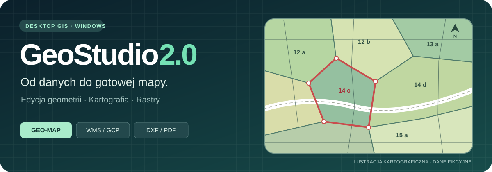
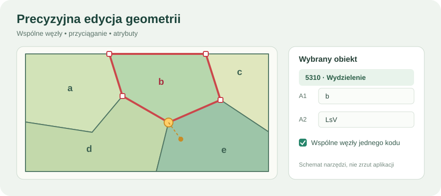
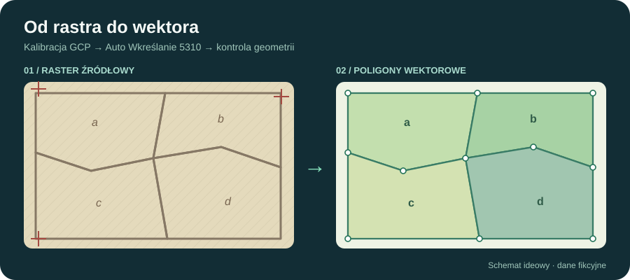

<div align="center">



<br>

**Nowoczesny edytor map geodezyjnych i leśnych dla Windows.**  
Pracuj na danych GEO-MAP, edytuj geometrię, wykorzystuj podkłady rastrowe i przygotowuj mapy w wybranej skali.

[](https://github.com/wskakuj/GeoStudio/releases)
[](https://www.python.org/)
[](https://fastapi.tiangolo.com/)
[](https://github.com/wskakuj/GeoStudio/tree/feat/raster-trace-5310)

[**Pobieranie / Releases**](https://github.com/wskakuj/GeoStudio/releases) · [**Funkcje**](#możliwości) · [**Uruchomienie**](#uruchomienie) · [**Zgłoś problem**](https://github.com/wskakuj/GeoStudio/issues)

</div>

---

## O GeoStudio

**GeoStudio** to niezależny projekt desktopowego środowiska GIS, rozwijany z myślą o praktycznej edycji map w formacie `.MAP` oraz pracy z bibliotekami kartograficznymi GEO-MAP. Łączy narzędzia geometrii, obsługę warstw i atrybutów z podkładami rastrowymi oraz oprawą kartograficzną.

Szczególny nacisk kładzie na opracowania leśne, wydzielenia (kod `5310`), działki ewidencyjne, klasoużytki i granice obrębów.

> [!NOTE]
> Poniższy opis dotyczy rozwijanej wersji **GeoStudio 2.0** z gałęzi [`feat/raster-trace-5310`](https://github.com/wskakuj/GeoStudio/tree/feat/raster-trace-5310). Domyślna gałąź `main` zawiera starszą bazę projektu. Ilustracje w README są schematami wykonanymi na fikcyjnych danych, a nie zrzutami ekranu aplikacji.

## Możliwości

| Edycja i geometria | Kartografia i dane |
| :--- | :--- |
| Rysowanie poligonów i linii | Warstwy działek, wydzieleń i klasoużytków |
| Przesuwanie, dodawanie i usuwanie węzłów | Biblioteki `.SYM`, `.LAY` i `.CDF` |
| Przyciąganie i wspólne węzły jednego kodu | Style obrysów, wypełnień i etykiet |
| Scalanie, wycięcia i edycja grupowa | Niezależne opisy A1/A2, legenda i róża kierunków |
| Cofanie i ponawianie zmian | Skala opracowania, powierzchnie i oprawa mapy |
| Filtrowanie po kodzie i atrybutach | WMS Geoportalu, lokalne rastry i kalibracja GCP |

### Edycja bez zbędnych kroków



Wybieraj obiekty na mapie, filtruj je według kodu i wartości A1/A2, zmieniaj geometrię i atrybuty pojedynczo lub grupowo. Wspólne węzły ograniczone do tego samego kodu pomagają zachować przylegające granice bez niezamierzonej edycji innych kategorii obiektów.

### Auto Wkreślanie wydzieleń



Połącz podkład rastrowy z geometrią mapy. Narzędzie **Auto Wkreślanie** w rozwijanej wersji 2.0 służy do tworzenia wydzieleń `5310` na podstawie skalibrowanego rastra. Wynik wymaga kontroli i ewentualnej ręcznej korekty.

Proste boki są dopasowywane do całej kreski z ograniczoną tolerancją, a sąsiadujące pola zachowują wspólną granicę. Tryby **Dokładna / Szybsza** i **Delikatne / Proste boki / Drżąca kreska** pozwalają dobrać rozpoznawanie do skanu. Numer A1 nadal wpisuje użytkownik; odczyt odręcznych numerów i wysięgników nie jest jeszcze dostępny. [Opis ustawień i dokładności](docs/auto-wkreslanie.md).

### Od podkładu do wydruku

- **Podkłady online:** ortofotomapy i działki ewidencyjne GUGiK/KIEG przez WMS.
- **Rastry lokalne:** PNG, JPG, TIFF/GeoTIFF, WebP oraz pojedynczy arkusz PDF; wczytywanie georeferencji i wizualna kalibracja GCP.
- **Oprawa mapy:** tytuł, legendy, oznaczenia, róża kierunków, wykonawca i skala opracowania.
- **Eksport:** PNG, JPG, TIFF, PDF i DXF oraz kopia pliku MAP; zakres i skala zależnie od wybranego trybu.

## Uruchomienie

### Wydania dla Windows

Przejdź do sekcji [**GitHub Releases**](https://github.com/wskakuj/GeoStudio/releases), aby sprawdzić dostępność gotowego wydania. W chwili aktualizacji dokumentacji binarne wydanie publiczne nie było jeszcze dostępne.

### Uruchomienie wersji 2.0 ze źródeł

**Wymagania:** Windows, Python 3.11+ oraz Microsoft Edge WebView2 (dla natywnego okna). Potrzebne jest połączenie z internetem podczas pierwszej instalacji zależności.

```powershell
git clone --branch feat/raster-trace-5310 --single-branch https://github.com/wskakuj/GeoStudio.git
cd GeoStudio
.\start_web_ui.bat
```

Skrypt tworzy osobne środowisko `.venv-web` i instaluje zależności. Jeśli natywne okno nie działa, dostępny jest tryb przeglądarkowy:

```powershell
.\start_web_ui.bat --browser
```

Po uruchomieniu wybierz plik MAP, wczytaj własne biblioteki kartograficzne i pracuj na kopii danych.

## Formaty

| Format | Zastosowanie |
| :--- | :--- |
| `.MAP` | Odczyt, edycja i zapis kopii mapy |
| `.SYM` / `.LAY` / `.CDF` | Symbole, warstwy i style (częściowa interpretacja) |
| PNG / JPG / TIFF / GeoTIFF / WebP / PDF (jeden arkusz) | Podkłady rastrowe; eksport PNG/JPG/TIFF |
| WMS | Podkłady i nakładki online |
| DXF | Eksport geometrii do narzędzi CAD |
| PDF | Eksport arkusza do wydruku w wersji 2.0 |

## Skróty klawiaturowe

| Skrót | Działanie |
| :--- | :--- |
| `S` | Zaznaczanie |
| `H` | Przesuwanie widoku |
| `P` | Edycja węzłów |
| `E` | Parametry obiektu |
| `Ctrl + H` | Filtr zaznaczenia wg kodu i atrybutów |
| `Ctrl + Shift + E` | Zbiorowa edycja A1/A2 |
| `Ctrl + Z` / `Ctrl + Y` | Cofnij / ponów |
| `Ctrl + Alt + L` | Konfiguracja etykiet |
| `G` | Magnes w trybie rysowania |

## Technologia

GeoStudio 2.0 wykorzystuje Python i FastAPI jako lokalny backend, HTML Canvas 2D do renderowania mapy oraz pywebview / WebView2 jako obudowę desktopową. Starsza wersja korzysta z PySide6. Operacje geometrii, format MAP, kartografia i eksport rozwijane są razem z testami regresyjnymi.

## Dokumentacja i bezpieczeństwo danych

- [Instrukcja GeoStudio 2.0](https://github.com/wskakuj/GeoStudio/blob/feat/raster-trace-5310/geostudio/web_app/README.md)
- [Dokumentacja formatu MAP](docs/FORMAT.md)
- [Historia starszych wersji i instrukcje](docs/LEGACY_README.md)
- [Zgłaszanie błędów](https://github.com/wskakuj/GeoStudio/issues)

> [!IMPORTANT]
> GeoStudio jest niezależnym projektem w rozwoju, nie oficjalnym produktem GEO-MAP ani certyfikowanym narzędziem do dokumentacji urzędowej. Pracuj na kopiach plików, sprawdzaj zgodność zapisanych danych w GEO-MAP i weryfikuj wyniki powierzchni oraz transformacji współrzędnych. Biblioteki i dane użytkownika nie są dołączone do repozytorium.

## Licencja

Repozytorium jest publiczne, ale nie zawiera obecnie wybranej licencji kodu. Nie oznacza to automatycznie zgody na dowolne rozpowszechnianie lub wykorzystanie kodu. Biblioteki oraz dane GEO-MAP mogą podlegać odrębnym prawom.

---

<div align="center">

**GeoStudio** · Niezależny projekt rozwijany przez [wskakuj](https://github.com/wskakuj)

*Mapy. Geometria. Kartografia.*

</div>
