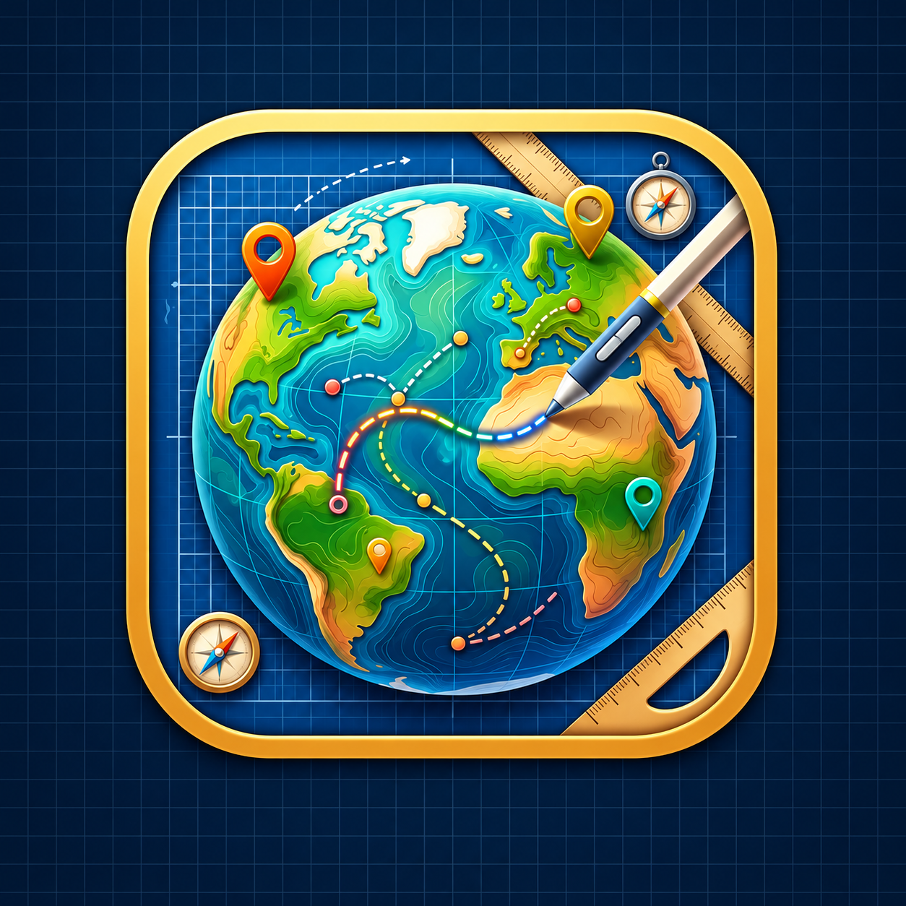

  
  <h1>GeoStudio</h1>
  
<strong>Edytor map geodezyjnych GEO-MAP na Windows</strong>

  
Otwieraj, przeglądaj i edytuj mapy .MAP w nowoczesnym środowisku GIS.

  

    
    
    
    
  

  
<a href="https://github.com/wskakuj/GeoStudio/releases/latest"><strong>Pobierz GeoStudio</strong></a> · <a href="https://wskakuj.github.io/GeoStudio/">Strona projektu</a> · <a href="https://github.com/wskakuj/GeoStudio/issues">Zgłoś problem</a>

---

> **Wczesna wersja 0.15.0.** GeoStudio jest rozwijanym projektem i nie zastępuje GEO-MAP w pracy urzędowej. Przed użyciem danych w pracy zawodowej sprawdź wynik w swoim standardowym narzędziu. Zachowuj kopię źródłowego pliku .MAP.

## Co możesz zrobić

- Otwierać tekstowe mapy GEO-MAP v8 (.MAP) i przeglądać obiekty, atrybuty, wierzchołki oraz warstwy.
- Wskazywać obiekty kliknięciem, dodawać je przez Ctrl+klik albo zaznaczać całe prostokątne obszary.
- Filtrować zaznaczenie po kodzie. Wybierz kod na liście filtra i przeciągnij prostokąt — zaznaczą się tylko widoczne obiekty tego kodu.
- Dodawać geometrię, edytować atrybuty, przeglądać etykiety oraz korzystać z przyciągania do geometrii.
- Ładować rastry i podkłady WMS, a wyniki zapisywać do nowych plików i eksportować m.in. do PNG, JPG, TIFF oraz DXF.

### Zaznaczenie prostokątem z maską kodu

1. Przejdź do narzędzia **Zaznaczanie**.
2. Wybierz kod na liście filtra (pozostaw pustą, aby uwzględnić wszystkie kody).
3. Przytrzymaj lewy przycisk myszy i przeciągnij prostokąt po mapie.
4. Przytrzymaj Ctrl podczas przeciągania, aby dodać wyniki do bieżącego zaznaczenia.

Zaznaczenie uwzględnia widoczność warstw. Obiekt zostaje wybrany, jeśli jego zasięg geometrii przecina prostokąt.

## Pobieranie i uruchomienie

Najnowszy plik **GeoStudio.exe** znajduje się na stronie [Wydania](https://github.com/wskakuj/GeoStudio/releases/latest). Wydanie jest budowane w GitHub Actions dla 64-bitowego Windows 10/11.

Jeśli wolisz uruchomić kod źródłowy, zainstaluj Python 3.11 lub nowszy, pobierz repozytorium i uruchom w PowerShell:

~~~powershell
python -m pip install -e .
python -m geostudio
~~~

## Wizualny przewodnik

Na [stronie GeoStudio](https://wskakuj.github.io/GeoStudio/) znajdziesz opis funkcji, ilustracje mapy, zaznaczania i przygotowania wydruku oraz odnośniki do pobrania.

## Zakres i ograniczenia

GeoStudio koncentruje się na edycji tekstowych plików GEO-MAP. Pełna zgodność prezentacji wszystkich symboli .SYM, bibliotek .LAY i .CDF, wszystkie warianty eksportu oraz pomiary powierzchniowe wymagają dalszej weryfikacji. Program nie odgaduje układu współrzędnych. Wyświetlone pole geometrii może różnić się od pola ewidencyjnego lub wartości zapisanej w źródłowej mapie.

Pracuj na kopiach plików. Zachowanie nieznanych rekordów i sumy kontrolnej pomaga chronić dane, ale nie jest gwarancją zgodności każdej mapy z komercyjnym GEO-MAP.

## Dokumentacja

- [Instrukcja interfejsu webowego 2.0](geostudio/web_app/README.md)
- [Format plików MAP](docs/FORMAT.md)
- [Obsługa rastrów i WMS](docs/ONLINE_MAPS.md)
- [Kalibracja rastrów](docs/RASTER_CALIBRATION.md)
- [Eksport i etykiety](docs/LAYOUT_EXPORT_AND_LABELS.md)
- [Historia zmian](docs/KNOWN_BEHAVIOUR.md)

## Zgłoszenia i rozwój

Masz pomysł albo trafiłeś na błąd? [Otwórz zgłoszenie](https://github.com/wskakuj/GeoStudio/issues) i dołącz opis kroków oraz — jeśli to możliwe — mały plik testowy bez danych poufnych.

---

GeoStudio · Windows · Python · PySide6

